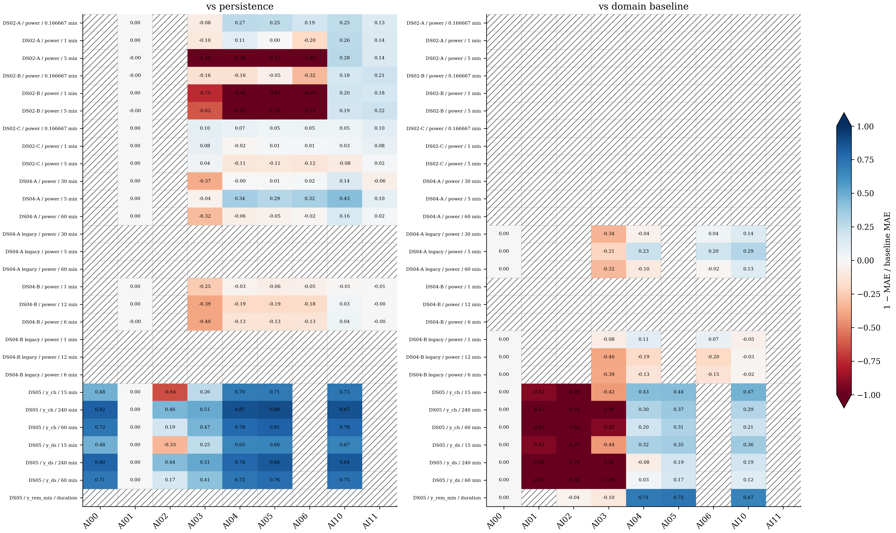

# Cross-dataset forecasting benchmark

Boundary: LOCAL_RUN on MEASURED source observations; forecasts and metrics DERIVED. These are independently trained within-dataset benchmarks, NOT cross-dataset transfer. They do not establish energy savings or superiority over published work. No classification accuracy is compared with NMAE.

| Dataset / evaluation | Split | Horizons (minutes) | Baselines |
|---|---|---|---|
| DS02 A/B/C | chronological 70/15/15, contiguous windows | 1/6, 1, 5 | last observation persistence; domain baseline unavailable |
| DS04 A/B, common framework | stored split, contiguous windows | A: 5, 30, 60; B: 1, 6, 12 | last observation persistence; domain baseline unavailable |
| DS04 A/B, legacy | stored split, separate training protocol | A: 5, 30, 60; B: 1, 6, 12 | four-slot rolling mean as domain proxy; persistence unavailable |
| DS05 | chronological 70/15/15 per module | power: 15, 60, 240; duration: not applicable | previous cycle at same elapsed time; last-observation persistence for power only |

Skill is 1 − model MAE / baseline MAE on the same evaluation. Missing or zero baselines yield NaN and hatched cells; values outside the color range retain their numerical labels. DS02/DS04 common-framework persistence skill is taken from the original metric: its denominator is the raw last observation, while the M0 P50 includes a training residual adjustment. Legacy DS04 uses its own rolling-mean P50 as a domain proxy and is not mixed with the newer run. DS05 duration has no persistence baseline. A missing horizon on duration means that the target is remaining time, not a zero-minute forecast.

| Standard ID | Legacy labels / meaning |
|---|---|
| AI00 | DS05 AI00_prev_cycle; DS04 F01 rolling-mean domain proxy |
| AI01 | M0 persistence with residual-adjusted P50; DS05 AI01_persistence |
| AI02 | DS05 AI02_uc_median, per-use-case median (not seasonal naive) |
| AI03 | M1 and F02 ordinary linear regression; DS05 AI03_ridge |
| AI04 | M2, F03, AI04_rf random forest |
| AI05 | M3, AI05_xgb XGBoost |
| AI06 | M4, F04 LightGBM |
| AI10 | M5, F05, AI10_lgbm_quantile quantile LightGBM P50 |
| AI11 | M6 TCN |

The shared IDs group related models; AI03 includes ordinary linear regression as well as ridge, and AI02 is a recipe median rather than a seasonal naive. NMAE denominators and data domains differ across protocols. DS04 legacy prediction time is for the whole test set and is not presented as per-sample latency. Width is unavailable in these metric files; DS05's `pinball` is not interval width. The table records per-sample latency only when available, source paths and missing-baseline reasons. No retraining was performed. Reproduce with `PYTHONPATH=src python -m regenate.forecasting.xbench`; outputs and source provenance are under `runs/run3/xbench/` and `figures/F04_v3.provenance.json`.
